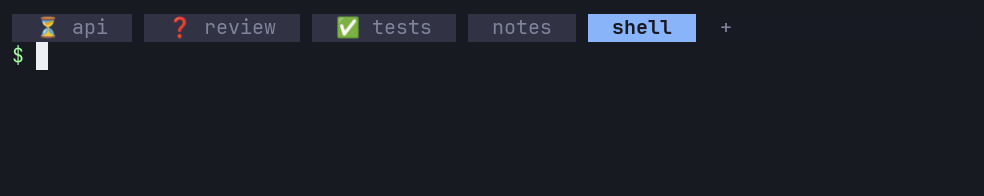
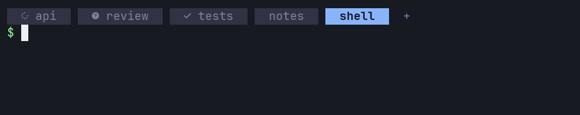

# Configuration & presets

Settings live in `config.json` in the plugin's config directory. `herdr plugin list` shows the directory. Normally the file is `~/.config/herdr/plugins/config/dvoraj75.cowbell/config.json`. A missing file means defaults.

## Presets

| Preset | working | blocked | done | Notes |
| --- | --- | --- | --- | --- |
| `ask` (default) | `◐` | `?` | `✓` | |
| `symbols` | `◐` | `×` | `✓` | Like herdr's `status_indicators = "symbols"`. |
| `emoji` | `⏳` | `❓` | `✅` | Two cells wide. The only preset with colour. |
| `nerd` | U+F110 | U+F059 | U+F00C | Needs a Nerd Font. The glyphs vanish in many fonts. |
| `custom` | from `config.json` | | | No icons of its own. |

*Cowbell: next icon preset* cycles ask → symbols → emoji → nerd → custom → ask and writes `preset` into `config.json`. `custom` is skipped unless `icons` sets at least one non-empty icon.

## Preset gallery

The captures come from a sandbox herdr 0.9.3 server on 2026-10-30. `api` is working, `review` is blocked, `tests` is done and not seen yet, `notes` is idle, and `shell` has no agent.

### ask


Text capture: [captures/ask.txt](captures/ask.txt)

### symbols


Text capture: [captures/symbols.txt](captures/symbols.txt)

### emoji



Text capture: [captures/emoji.txt](captures/emoji.txt)

### nerd



Text capture: [captures/nerd.txt](captures/nerd.txt)

### custom

```json
{"preset": "custom", "icons": {"working": "»", "blocked": "!", "done": "*"}}
```


Text capture: [captures/custom.txt](captures/custom.txt)

## All keys

| Key | Type | Default | Meaning |
| --- | --- | --- | --- |
| `preset` | string | `"ask"` | One of `ask`, `symbols`, `emoji`, `nerd`, `custom`. |
| `icons` | object | `{}` | Overrides single states of the preset. |
| `icons.working` | string | preset value | Icon for working tabs. |
| `icons.blocked` | string | preset value | Icon for tabs waiting for you. |
| `icons.done` | string | preset value | Icon for finished tabs not seen yet. |
| `icons.idle` | string | preset value (none) | Icon for idle tabs. |
| `icons.unknown` | string | preset value (none) | Icon for tabs with an unknown state. |
| `separator` | string | `" "` | Placed between icon and name. |
| `include_auto_named` | boolean | `false` | Also put icons on auto-named tabs. See [below](#include_auto_named). |
| `spinner.enabled` | boolean | `false` | Animate the icon of working tabs. See [Spinner](#spinner). |
| `spinner.frames` | array of strings | `["◐","◓","◑","◒"]` | Frames shown in turn. Must be a non-empty array of non-empty strings. Duplicates are dropped. |
| `spinner.interval_ms` | number | `1000` | Time between frames in milliseconds. Values below 1000 are raised to 1000. |

In `icons`, an empty string `""` removes the icon for that state. Keys other than the five states are rejected.

A full file with every key at its default:

```json
{
  "preset": "ask",
  "icons": {},
  "separator": " ",
  "include_auto_named": false,
  "spinner": {
    "enabled": false,
    "frames": ["◐", "◓", "◑", "◒"],
    "interval_ms": 1000
  }
}
```

## Invalid files

An invalid file (bad JSON, unknown preset or state, wrong type) logs one line. Cowbell keeps the last good config, or the defaults if there is none. A typo cannot stop the daemon.

## When changes apply

- *Cowbell: next icon preset* signals the daemon to reload `config.json` (SIGUSR2). It applies immediately.
- *Cowbell: refresh now* does not reload the file.
- A hand edit applies on the next daemon start. While the daemon runs, run *Cowbell: on/off* twice: the first turns cowbell off, the second starts a fresh daemon that reads the file. When no daemon runs, once is enough. Or restart the herdr server.

## Spinner

With `spinner.enabled` set to `true`, working tabs show animated frames.

- Only working tabs are animated.
- One timer drives all of them, so every tab shows the same frame.
- The timer runs only while at least one tab is working.
- The frames replace the working icon of any preset and any `icons.working` override.
- Frames are always stripped from labels, so changing them or turning the spinner off leaves no stale frame.
- Each frame is a tab rename. It wakes every plugin that listens to `tab.renamed`.

Keep it off unless you want it.

## include_auto_named

An auto-named tab still has herdr's automatic name, its position in the workspace. By default cowbell leaves such tabs alone.

herdr cannot turn a renamed tab back into an auto-named one. Once cowbell adds an icon, the tab keeps a fixed name, even after cowbell is off or removed. With the option on, cowbell keeps the number in sync with the tab's position while it runs. After *off* the tab keeps its last number. That is why the option is opt-in.
