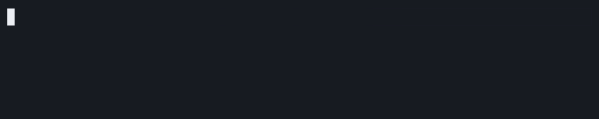

# herdr-cowbell

herdr-cowbell is a [herdr](https://herdr.dev) plugin that puts each tab's agent status as an icon in front of the tab name.



## The icons

The default preset (`ask`) uses three icons:

| Icon | Agent state | Meaning |
| --- | --- | --- |
| `◐` | working | The agent is busy. |
| `?` | blocked | The agent is waiting for you. |
| `✓` | done | The agent finished and you have not seen the tab yet. |

Idle and unknown agents show nothing. Other presets and your own icons are described in [Configuration & presets](configuration.md).

## Why the icon is in the label

herdr's tab bar draws only the tab label. There is no per-tab icon slot and no styling. So cowbell renames the tabs: the icon becomes part of the name.

This has consequences:

- Colour is only possible with an emoji preset. Other icons take the tab bar's text colour.
- Other plugins that listen to `tab.renamed` wake on every icon change.
- Cowbell renames a tab only when the label it wants differs from the current one.

See [How it works](how-it-works.md) and [Limitations & troubleshooting](troubleshooting.md) for more.

## Quick start

```sh
herdr plugin install dvoraj75/herdr-cowbell
```

Requirements:

- herdr 0.9.2 or newer
- Node 18 or newer on `PATH` as `node`
- Linux or macOS

See [Install & update](install.md) for when the daemon starts and for updating.

## Where next

- [Install & update](install.md)
- [Configuration & presets](configuration.md)
- [Actions & key bindings](actions.md)
- [How it works](how-it-works.md)
- [Limitations & troubleshooting](troubleshooting.md)
- [Changelog](changelog.md)
- [Contributing](contributing.md)
